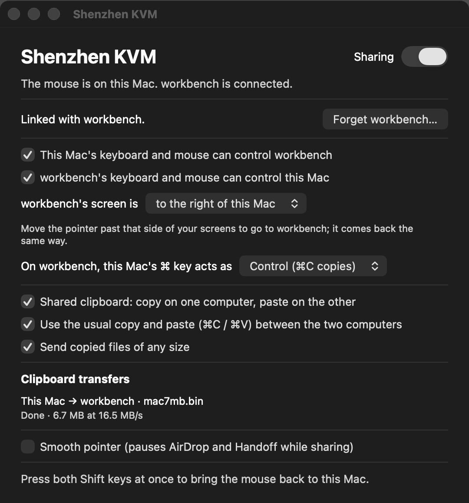
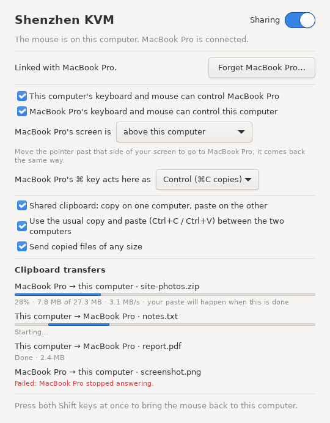

# Shenzhen KVM

One keyboard, mouse and clipboard for a Mac and a Linux computer on the same network. Push the pointer past the edge of one screen and it carries on on the other computer, with its keyboard; copy on one and paste on the other, text, pictures and files.

<a href="https://github.com/casimir-engineering/shenzhen-kvm/releases/latest/download/ShenzhenKVM.dmg"></a>

Mac: Apple Silicon · macOS 14+ · Signed and notarized. Linux: built from this repository (Ubuntu 22.04 and later; X11 or Xwayland desktops).



## What it does

- **Both ways.** The Mac's keyboard and mouse work on the Linux computer, and the Linux computer's keyboard and mouse work on the Mac. Choose which side of your screens the other computer is on; the pointer crosses there and comes back the same way. Press both Shift keys to bring it back at once.
- **Shortcuts act where the pointer is.** While the pointer is on the other computer, every key goes there, including the ones macOS keeps for itself: ⌘Tab switches windows there (Alt+Tab on Linux, held while ⌘ is held), ⌘Space, Mission Control keys, screenshots. ⌘ acts as Control on Linux (⌘C copies), or as Super if you prefer; the Mac's Control then reaches Super. Volume and playback keys go to the computer the pointer is on; brightness stays on the Mac.
- **One clipboard.** Copy on one computer, paste on the other with the usual shortcuts. Files and folders are sent in the background as soon as you copy them, with their progress in the window; a paste pressed before they arrive waits for them. Received files land in Downloads, in a folder named after the other computer. You can keep files over a size limit from being sent, or use two dedicated shortcuts instead of the usual copy and paste.
- **Smooth over Wi-Fi.** The Mac can pause AirDrop and Handoff while the pointer is on the other computer, which keeps its Wi-Fi on the network's channel (a one-time setup, **Set Up…** in the window).
- **Settings in either window.** Both computers show the same settings and keep them in step.

## Linking

The two computers link once, then find each other by themselves, also after their addresses change.

1. Open Shenzhen KVM on both computers (on Linux: the keyboard icon in the top bar, or `shenzhen-kvm visible` in a terminal).
2. On one of them, choose **Make this computer visible** (it stays visible for 5 minutes).
3. On the other, choose it under **Visible computers** and **Link** (or `shenzhen-kvm link`).
4. Both show the same six-digit code. Check that they match and confirm on both.

To unlink, choose **Forget …** in either window (or `shenzhen-kvm forget`); the other computer forgets the link too.

Computers on the same network find each other in several ways at once (the network's name service, broadcast, multicast, IPv6 and, as a last resort, asking each nearby address), so networks that block one of them still work. A VPN is never used for this.

## Install

**Mac:** download `ShenzhenKVM.dmg` with the button above, open it and drag Shenzhen KVM onto Applications. When you first open it, allow it to use the keyboard and mouse (System Settings › Privacy & Security › Accessibility); it starts by itself when you log in. Opened straight from the disk image, it offers to move itself to Applications.

**Linux:** on the Linux computer, as root, from a copy of this repository:

```bash
sudo apt install gcc libsodium-dev libx11-dev python3-gi gir1.2-gtk-3.0
sudo linux/install.sh          # builds, installs and starts the service and the top-bar app
sudo linux/install.sh --undo   # takes it out again
```

The service runs as root (it needs `/dev/uinput` to type and point); the top-bar app runs as the person at the desktop, with the same window as the Mac. See [linux/README.md](linux/README.md).



## Updates

The Mac app checks for a new version once a day and asks before installing it. **Check for Updates…** in the app menu checks now.

## Build

```bash
./build.sh            # build/Shenzhen KVM.app, signed with the Developer ID (keeps the Accessibility permission across rebuilds)
./build.sh --release  # notarized app and disk image, build/ShenzhenKVM.dmg
```

The Mac app is Swift in `mac/Sources`, no Xcode project; `mac/icon/make-icon.swift` draws the icon. The Linux side is one C program (`linux/shenzhen-kvm.c`, with its parts in `linux/src/`) and a Python GTK app (`linux/shenzhen-kvm-tray`). Both follow [PROTOCOL.md](PROTOCOL.md).

For checks from a terminal, the Mac app takes `--state`, `--hello`, `--ping N`, `--clip-get` and `--clip-put-text TEXT`; on Linux, `shenzhen-kvm status` prints the service's state.
